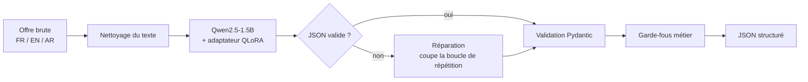
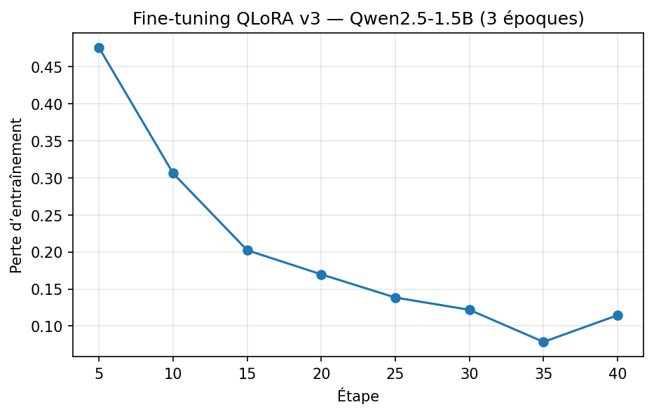

# Extraction structurée d'offres d'emploi tunisiennes avec un LLM fine-tuné

Un petit modèle de langage (**Qwen2.5-1.5B-Instruct**) fine-tuné avec **QLoRA** pour transformer une offre d'emploi ou de stage brute, en **français, anglais ou arabe**, en un JSON structuré : poste, entreprise, ville, type de contrat (PFE, stage, CDI, SIVP…), mode de travail, durée, rémunération, langue et compétences.

C'est la première brique d'un agent de tri d'offres : l'étape suivante compare les compétences extraites à un CV.

> Projet réalisé en octobre 2026 sur un GPU T4 gratuit (Google Colab), avec un dataset annoté à la main.

---

## En bref

Résultats sur un **test vierge** : 14 nouvelles offres, annotées sans regarder aucune sortie de modèle et jamais utilisées pour prendre une décision.

| | Modèle de base | **Pipeline final (v3)** |
|---|---|---|
| Sorties qui respectent le schéma | 3 / 14 | **13 / 14** |
| F1 des compétences | 0,19 | **0,50** |
| Ville correcte | 4 / 14 | **13 / 14** |
| Langue correcte | 8 / 14 | **13 / 14** |
| Type de contrat correct | 9 / 14 | **11 / 14** |

Sur le test utilisé pendant le développement, le F1 des compétences atteignait 0,70. L'écart avec le test vierge (0,50) montre que ce premier test était optimiste ; les deux chiffres sont présentés plus bas.

Ce qui a compté le plus n'est pas l'entraînement lui-même, mais **l'analyse d'erreurs** : elle a révélé des boucles de répétition (corrigées en changeant l'ordre des champs), puis des étiquettes incomplètes (corrigées par une réannotation avec un guide précis).

---

## Pipeline



1. **Nettoyage** : suppression du texte d'interface copié avec la page (« Sauvegarder », nombre de candidats, titre répété).
2. **Modèle fine-tuné** : extraction guidée par un prompt système qui reprend les règles du guide d'annotation.
3. **Réparation** : si le modèle boucle sur la liste des compétences, la liste est coupée au premier doublon et le JSON est refermé. Possible parce que `competences` est le **dernier** champ.
4. **Validation** du schéma avec Pydantic.
5. **Garde-fous** : règles simples et vérifiables (par exemple « Confidentiel » en rémunération devient `null`).

---

## Dataset

**68 offres** copiées à la main, puis annotées selon [`GUIDE_ANNOTATION.md`](GUIDE_ANNOTATION.md).

| Répartition | |
|---|---|
| Langues | français 45 · anglais 10 · arabe 13 |
| Contrats | CDI 30 · freelance 16 · PFE 9 · stage 7 · CDD 1 · non précisé 5 |
| Sources | TanitJobs 44 · Mostaql 10 · Keejob 5 · Hi Talents 5 · Bayt 3 · LinkedIn 1 |
| Découpage | 54 en entraînement · **14 en test** (stratifié par langue, au moins 2 PFE) |

Le découpage est figé (graine 42) : toutes les versions sont évaluées sur **exactement les mêmes 14 offres**.

Le dataset **n'est pas publié** : les textes des offres appartiennent aux sites qui les diffusent. Le schéma, le guide d'annotation, le code et les résultats sont publics.

### Schéma de sortie

```json
{
  "poste": "Stagiaire Développeur Full Stack",
  "entreprise": "RESPONSIVE WEB SYSTEMS",
  "ville": "Sousse",
  "type_contrat": "stage",
  "mode_travail": null,
  "duree_mois": null,
  "remuneration": "500 - 570 TND / Mois",
  "langue_offre": "fr",
  "competences": ["Node.js", "Express.js", "TypeScript", "MongoDB", "React", "Docker", "CI/CD"]
}
```

`type_contrat` ∈ {PFE, stage, CDI, CDD, SIVP, freelance} · `mode_travail` ∈ {présentiel, hybride, remote} · `langue_offre` ∈ {fr, en, ar}

---

## Entraînement

| Paramètre | Valeur |
|---|---|
| Modèle de base | `Qwen/Qwen2.5-1.5B-Instruct` |
| Méthode | QLoRA : quantification 4 bits NF4, double quantification |
| LoRA | r = 16, alpha = 32, dropout = 0,05, sur `q, k, v, o, gate, up, down_proj` |
| Paramètres entraînés | 18,5 M sur 1,56 Md (**1,18 %**) |
| Optimisation | 3 époques, lr 2e-4 cosinus, batch 1 × accumulation 4, `paged_adamw_8bit` |
| Longueur max | 2 560 tokens (le plus long exemple fait 2 432 tokens) |
| Perte | calculée **uniquement sur le JSON** (le prompt et l'offre sont masqués) |
| Matériel | 1 × T4 (Google Colab), environ 15 minutes |



La perte d'entraînement descend de 0,48 à environ 0,1. Il n'y a pas d'ensemble de validation séparé (trop peu de données) : c'est le jeu de test qui mesure la généralisation.

---

## Métriques

- **JSON valide / schéma respecté** : la sortie se parse-t-elle, et respecte-t-elle les types et valeurs autorisées ?
- **Exactitude par champ** : comparaison après normalisation (casse, espaces).
- **Poste souple** : même comparaison, sans ponctuation ni « (H/F) ».
- **Compétences P / R / F1** : précision (pas de compétence en trop), rappel (pas de compétence oubliée).
- **Taux d'ancrage** : part des compétences prédites présentes **mot pour mot** dans l'offre. Mesure directe des hallucinations. Il est un peu sous-estimé pour l'arabe, où les noms canoniques (« Python » pour « بايثون ») ne figurent pas dans le texte.

---

## Résultats

### Test de développement

Toutes les colonnes sont évaluées sur les **14 mêmes offres** et les **mêmes étiquettes (v3)**. Avec 14 offres, **une offre vaut 7 points** : les écarts d'une seule offre ne sont pas significatifs.

| Métrique | Base | v1 | v2 | v3 | **v3 + réparation + garde-fous** |
|---|---|---|---|---|---|
| JSON valide (brut) | 12/14 | 12/14 | 14/14 | 12/14 | 12/14 → **14/14 après réparation** |
| Schéma respecté | 1/14 | 12/14 | 14/14 | 12/14 | **14/14** |
| Poste (strict) | 2/14 | 6/14 | 7/14 | 6/14 | 8/14 |
| Poste (souple) | 2/14 | 9/14 | 11/14 | 8/14 | 10/14 |
| Entreprise | 10/14 | 13/14 | 13/14 | 14/14 | 13/14 |
| Ville | 2/14 | 10/14 | 12/14 | 12/14 | 13/14 |
| Type de contrat | 8/14 | 12/14 | 13/14 | 12/14 | 13/14 |
| Mode de travail | 4/14 | 14/14 | 14/14 | 14/14 | 14/14 |
| Durée | 9/14 | 10/14 | 12/14 | 9/14 | 9/14 |
| Rémunération | 8/14 | 14/14 | 14/14 | 12/14 | 14/14 |
| Langue | 7/14 | 11/14 | 13/14 | 11/14 | 13/14 |
| **Compétences F1** | 0,33 | 0,56 | 0,61 | 0,68 | **0,70** |
| Compétences précision | 0,49 | 0,65 | 0,68 | 0,77 | 0,73 |
| Compétences rappel | 0,25 | 0,50 | 0,55 | 0,61 | 0,67 |
| Taux d'ancrage | 0,60 | 0,86 | 0,92 | 0,86 | 0,79 |

**Lecture :**
- Le fine-tuning apprend d'abord **le format** : le schéma passe de 1/14 à 12/14 dès la v1.
- La v2 supprime les boucles de répétition sans rien changer d'autre.
- La v3, entraînée sur des étiquettes plus complètes, donne le meilleur **F1 des compétences** (0,70), le champ le plus utile pour le matching avec un CV.
- La v3 boucle à nouveau sur 2 offres (listes plus longues), mais la réparation les récupère entièrement grâce au choix de conception de la v2.

### Test vierge

Ce test de développement a servi à analyser les erreurs et à réviser les étiquettes : il est donc optimiste. Pour obtenir une mesure honnête, **14 nouvelles offres** ont été collectées et annotées avec le guide v3.1, **sans regarder aucune sortie de modèle** : 8 en français, 3 en anglais, 3 en arabe ; 6 CDI, 3 stages, 2 PFE, 2 missions freelance ; dont une offre hors informatique (RSE) et 4 offres LinkedIn, un format presque absent de l'entraînement. Le modèle n'a pas été réentraîné après ce test.

| Métrique | Base | v3 | **v3 + réparation + garde-fous** |
|---|---|---|---|
| JSON valide (brut) | 13/14 | 12/14 | 12/14 → **14/14 après réparation** |
| Schéma respecté | 3/14 | 11/14 | **13/14** |
| Poste (souple) | 5/14 | 5/14 | 7/14 |
| Entreprise | 12/14 | 13/14 | 14/14 |
| Ville | 4/14 | 13/14 | 13/14 |
| Type de contrat | 9/14 | 9/14 | 11/14 |
| Mode de travail | 7/14 | 9/14 | 9/14 |
| Durée | 9/14 | 11/14 | 11/14 |
| Rémunération | 8/14 | 11/14 | 13/14 |
| Langue | 8/14 | 12/14 | 13/14 |
| **Compétences F1** | 0,19 | 0,47 | **0,50** |
| Compétences précision | 0,30 | 0,66 | 0,62 |
| Compétences rappel | 0,14 | 0,37 | 0,43 |
| Taux d'ancrage | 0,67 | 0,74 | 0,68 |

**Ce que montre le test vierge :**
- **Le format et les champs simples généralisent bien** : schéma, entreprise, ville et langue restent au niveau du test de développement.
- **Les compétences baissent nettement** (F1 0,70 → 0,50). Le problème principal est le **rappel** : le modèle prédit en moyenne 10,7 compétences par offre alors que les étiquettes en comptent 15,6, et il résume parfois au lieu de lister (« développement web full-stack » au lieu de JavaScript, TypeScript, Node.js, React…).
- **Des noms non canoniques** : « Prisma ORM » au lieu de « Prisma », « REST APIs » au lieu de « API REST », « Lambda » au lieu de « AWS Lambda ». Un dictionnaire de normalisation en post-traitement corrigerait une partie de ces écarts.
- **Un format nouveau dérange le modèle** : sur les offres LinkedIn, il réécrit le titre du poste et ne reconnaît pas « Sur site » comme `présentiel` (il renvoie une fois `"sur site"`, hors schéma).
- **Le biais « arabe = freelance » identifié pendant la constitution du dataset se confirme** : sur l'offre d'emploi saoudienne, le modèle invente `freelance` et `rémunéré`.
- **Arabe** : sur une mission Mostaql, il invente un titre (« Mouvement Salle Pro ») et produit des variantes répétitives de compétences (« développement d'applications mobile responsive design »…), une forme de boucle que la réparation ne détecte pas car les éléments ne sont pas strictement identiques.
- **Les limites connues sont confirmées** : conversion des jours en mois fausse (9 jours → 0,17), et durée en fourchette ignorée (« 3 à 6 mois » → `null`), puisque la règle v3.1 a été ajoutée après l'entraînement de la v3.

---

## Démarche : ce que chaque version a appris

### Baseline — le modèle de base ne suit pas le format
Avec un simple prompt, Qwen2.5-1.5B produit du JSON valide mais **ne respecte le schéma que sur 1 offre sur 14** : valeurs hors liste (« hybride » comme type de contrat, « fr, en, ar » comme langue), tâches et diplômes mélangés aux compétences, champs inventés.

### v1 — premier fine-tuning
Le schéma passe à 12/14 et le F1 des compétences de 0,33 à 0,56. Mais **2 sorties sur 14 ne sont pas du JSON valide**.

### Diagnostic — des boucles de répétition
Les deux sorties invalides sont des boucles dans la liste des compétences (« LLM », « LLM », « LLM »… jusqu'à la limite de tokens). Comme `competences` était au milieu du JSON, tous les champs suivants étaient perdus.

**Premier essai, raté :** une `repetition_penalty` au décodage. À 1,05, elle casse d'autres sorties (JSON valide 12/14 → 10/14) ; à 1,1, elle ne change rien. Piste abandonnée.

### v2 — corriger la cause, pas le symptôme
`competences` devient le **dernier champ** du JSON, et une fonction de réparation coupe une liste qui boucle. Résultat : 14/14 JSON valides, sans même avoir besoin de la réparation.

### Analyse d'erreurs — le modèle avait souvent raison
Sur les compétences « inventées » par la v2, **58 sur 74 figuraient en réalité dans l'offre** : des outils oubliés lors de l'annotation (Prometheus, Grafana, Cloudflare…). Le vrai problème était une définition floue de ce qu'est une compétence.

### v3 — réannotation avec un guide précis
Un test opérationnel (« est-ce que cela s'écrirait dans la rubrique Compétences d'un CV ? »), des noms canoniques uniques en alphabet latin, la séparation des compétences composées. Bilan : **211 compétences ajoutées, 21 retirées, 91 renommées**, journalisées dans `journal_reannotation_v3.csv`. Le F1 des compétences monte à 0,70.

### Durée — encore une règle manquante
La v3 « perd » 3 offres sur la durée. Analyse : deux offres PFE indiquent « Internship 3-6 months » mais étaient étiquetées `null` faute de règle pour les fourchettes. Sur l'une, le modèle avait la bonne réponse (3 mois). Règle ajoutée au guide (v3.1, borne basse) et étiquettes corrigées. **Les chiffres du test de développement ont été calculés avant cette correction.**

### Test vierge — la mesure honnête
14 nouvelles offres annotées à l'aveugle. Le format reste solide, mais le F1 des compétences tombe à 0,50 : voir la section Résultats.

---

## Limites

- **Tests de petite taille** (2 × 14 offres) : les écarts d'une offre ne sont pas significatifs.
- **Test de développement optimiste** : ses étiquettes ont été révisées après avoir observé les sorties de la v2. C'est pourquoi le chiffre de référence est celui du **test vierge**.
- **Rappel des compétences limité** sur les offres qui en listent beaucoup (jusqu'à 49 dans le test vierge).
- **Peu d'offres LinkedIn** à l'entraînement : le modèle généralise mal à ce format.
- **Arabe peu représentatif** : 10 des 13 offres en arabe sont des missions freelance (Mostaql), les 3 autres viennent d'Arabie saoudite, dont 2 traduites automatiquement par la plateforme. Aucune offre d'emploi tunisienne en arabe n'a été trouvée.
- **Arithmétique** : le modèle convertit mal les jours en mois (3 jours → 0,33 au lieu de 0,1).
- **Garde-fou de durée inefficace** : il devait forcer `null` quand l'offre ne contient aucune durée, mais il détecte « 3 ans d'expérience » comme une durée. Il n'a donc rien corrigé.
- **Un seul entraînement par version**, sans moyenne sur plusieurs graines.
- **Pas d'ensemble de validation** pour suivre le surapprentissage pendant l'entraînement.

---

## Prochaines étapes

1. **Dictionnaire de normalisation des compétences** en post-traitement, construit à partir du guide (« Prisma ORM » → « Prisma », « REST APIs » → « API REST »). Il servira aussi au matching.
2. **v4** : plus de données (offres LinkedIn, offres d'emploi en arabe hors freelance, listes de compétences longues), et `duree_mois` remplacé par `duree_valeur` + `duree_unite`, la conversion se faisant en code.
3. **Matching CV ↔ offre** : embeddings multilingues pour scorer la compatibilité, plus la liste des compétences communes et manquantes.
4. **Démo** : Space Hugging Face, puis application React + NestJS.

---

## Structure du dépôt

```
├── README.md
├── GUIDE_ANNOTATION.md          # règles d'annotation (référence unique)
├── notebooks/
│   ├── 01_baseline.ipynb        # test du modèle de base
│   ├── 02_annotation.ipynb      # outil d'annotation (widgets Colab)
│   ├── 03_finetuning_v1.ipynb   # découpage, baseline, QLoRA v1, évaluation
│   ├── 04_v2.ipynb              # compétences en dernier + réparation
│   ├── 05_v3.ipynb              # étiquettes v3 + métriques complètes
│   └── 06_test_vierge.ipynb     # évaluation sur le test vierge (sans réentraînement)
└── resultats/
    ├── comparaison_finale_v3.csv
    ├── comparaison_test_vierge.csv
    └── courbe_perte_v3.png
```

## Reproduire

1. Ouvrir les notebooks dans Google Colab avec un GPU T4.
2. Placer vos propres données dans `MyDrive/job-offer-extractor/data/` au format JSONL décrit dans le guide (`offre`, `extraction`, `source`, `url`).
3. Exécuter les notebooks dans l'ordre. Le notebook 03 crée le découpage train / test, que les suivants réutilisent.

**Stack :** Python · PyTorch · Hugging Face Transformers · PEFT · bitsandbytes · Pydantic · pandas

---

## Auteure

**Mayss Jaballi** — étudiante ingénieure en développement web, ESPRIT (Tunisie).
Je travaille principalement avec React et NestJS, et ce projet est ma porte d'entrée vers le ML appliqué.

<!-- Ajoute ici ton LinkedIn et ton email -->
